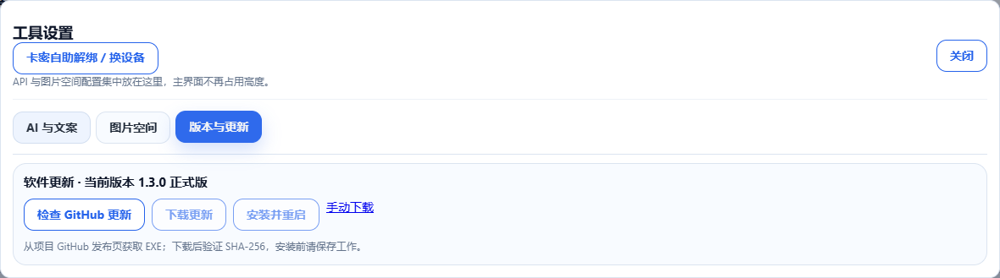
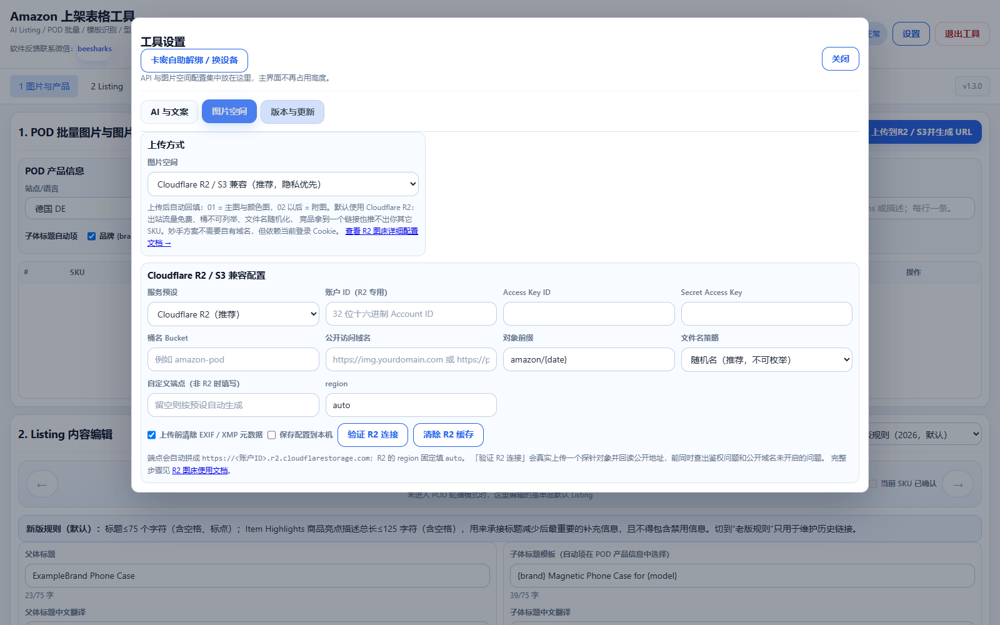

# AmazonListingTool

面向 Amazon 卖家的 Windows 桌面工具：AI Listing 文案、POD 批量处理、模板字段识别、父子变体配置与 Excel 上架表导出。

**本仓库仅发布 EXE 下载、操作说明和界面截图，不提供项目源码、配置文件、卡密或 API Key。**

## 下载

[下载 Windows EXE](https://github.com/wengdajie/AmazonListingTool/releases/download/v1.3.0/AmazonListingTool.exe) · [版本发布页](https://github.com/wengdajie/AmazonListingTool/releases/tag/v1.3.0)

- 版本：1.3.0，构建日期 2026-10-29。
- 1.3.0 正式版使用原生编译的授权模块，不包含 PyArmor 试用运行时。授权验证仍需有效卡密；公开下载不等于免费或永久授权。
- 适用于 Windows 桌面环境；使用内置 WebView，需要 Microsoft Edge WebView2 Runtime。
- EXE SHA-256：`AF26BC52926EB1E32C5A803DB4237B96979D830623B71113CB3D4E4F168AE978`。

## 快速开始

1. 下载 `AmazonListingTool.exe`，放入可写入的本地目录，双击启动。
2. 在激活窗口输入有效卡密，完成联网验证。
3. 打开右上角“设置”，选择 AI 服务商，填写自己的 API Key 和模型；可测试 API 或看图能力。调用按所选服务商计费。
4. 填写目标站点、品牌、类目和已确认的产品事实；单品可直接编辑 Listing，POD 模式先选择 SKU 图片文件夹并扫描。
5. 上传目标站点和类目的 Amazon `.xlsm/.xlsx` 模板，点击“识别模板并替换参数列表”。
6. 配置型号、颜色和变体主题，补齐必填参数与图片 URL，预览后导出。
7. 在 Seller Central 上传导出的表格，并检查处理报告。软件生成文件不代表平台已接受或商品已上架。

[完整操作手册与故障处理](docs/操作指南.md)

## 主要功能

- 生成和编辑标题、五点、描述、搜索关键词，提供中文核对内容。
- POD 按 SKU 批量扫描图片、分析主图和管理文案。
- 读取模板字段、必填提示、下拉选项，配置父子变体。
- 导出前检查标题长度、搜索词 UTF-8 字节、SKU、父 SKU 和变体属性。
- 默认中转在线模型目录同步，支持多种 AI 服务商。
- R2/S3 兼容、七牛及妙手图片空间配置。
- 卡密 RSA v2 验签、本地 DPAPI 缓存、自助解绑换机。
- 内置服务隐藏 API 地址，自定义服务按需输入；GitHub 检查、校验下载、安装与重启。

## 界面截图

以下为同版本界面的实际截图，使用隔离的空配置和演示数据采集；未包含真实密钥或已激活卡密。

### 主界面与 Listing 编辑

### AI 设置与自助解绑入口

### Amazon 模板导入

### 型号、颜色与父子变体

## 反馈

可通过 GitHub Issues 报告问题。请说明版本、操作步骤和错误提示；截图前遮盖卡密、API Key、Cookie、图床密钥与业务数据。

本工具为第三方工具，与 Amazon 官方无隶属关系。类目规则和条件必填以目标站点的最新模板及 Seller Central 处理结果为准。

## 1.3.0 改进

- 顶部六步流程导航；设置改为 AI 与文案、图片空间、版本与更新三组，支持键盘切换及焦点恢复。
- 设置保存状态可见；API Key、图床密钥与 Cookie 不再以明文保留在浏览器缓存，保存功能由后端 DPAPI 处理。
- 默认仅绑定本机地址，拒绝外部来源和非法 Host 请求。
- 更新器区分正式/预览渠道，当前正式版不会被重复推荐，失败检查会撤销旧候选版本。
- R2 上传按钮显示正确；导出校验失败释放工作簿，导出文件名精确到微秒。
- 授权模块使用原生扩展编译，包内含第三方许可说明；不包含源码或 PyArmor 试用运行时。

