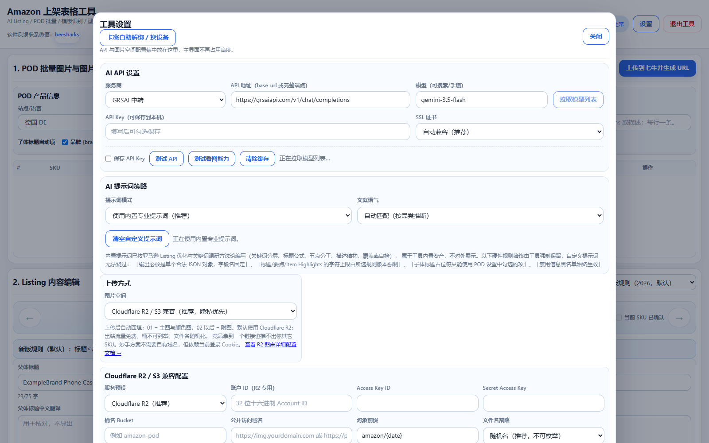
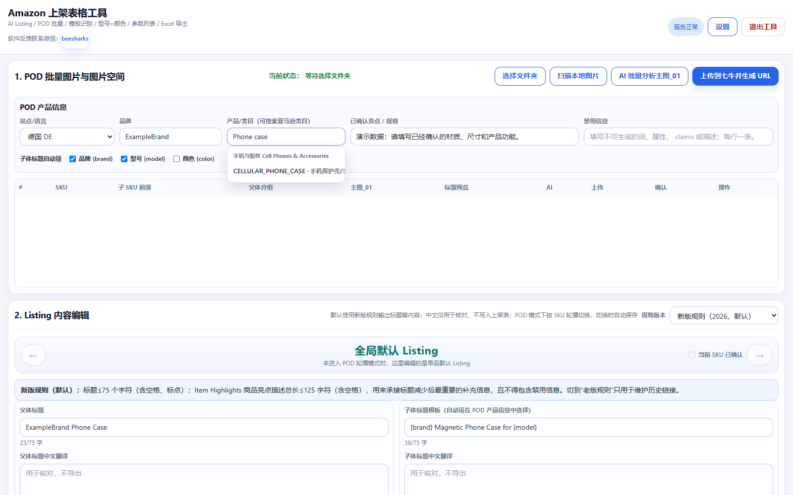
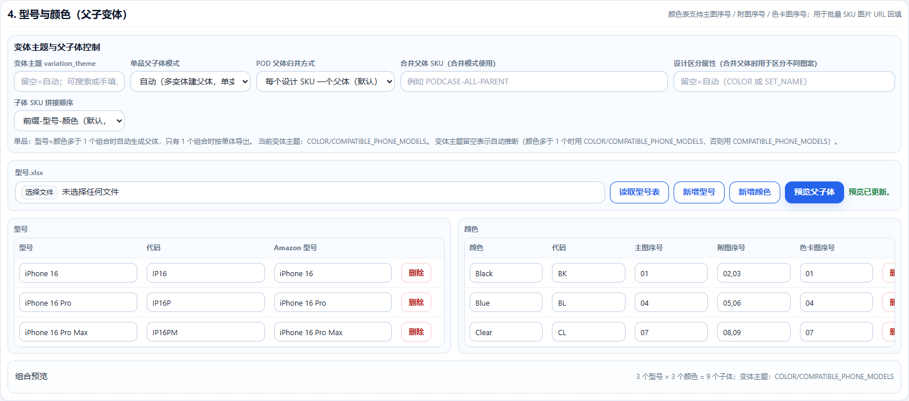

# AmazonListingTool 操作指南

适用版本：1.1.0 Preview。当前发布包是内部测试构建，暂不用于商业发行。

## 1. 下载、运行与激活

在仓库 README 或 Releases 下载 `AmazonListingTool.exe`。无需安装 Python；双击 EXE 后在授权窗口输入有效卡密。启动和心跳验证需要联网。若 WebView 组件报错，请通过 Microsoft 官方渠道安装或修复 Edge WebView2 Runtime。

请核对下载文件的 SHA-256（PowerShell）：

```powershell
Get-FileHash -LiteralPath .\AmazonListingTool.exe -Algorithm SHA256
```

预期值见版本发布页及 README。系统如报告安全问题，应先核对下载来源和文件哈希，再联系维护者确认。

## 2. 配置 AI 服务

点击主界面右上角“设置”。选择服务商，填写其 API 地址、模型名称以及你自己的 API Key。GrsAI 默认地址已经预填；可同步官网目录。其他兼容服务通常通过 `/models` 拉取列表；接口不支持时可手填模型名。

“测试 API”仅验证文本连接。“测试看图能力”会发送商品区第一张图片，请将返回描述与原图比对。模型目录不代表你的账户权限或看图能力。两类测试和生成请求均可能产生服务商费用。

可选择将凭证保存到本机；不要将自己的卡密、API Key 或设置文件上传到本仓库。



## 3. 准备产品事实与 Listing

选择销售站点和语言，填写品牌、类目、材质、尺寸、兼容性、包装数量等已确认事实。把不能出现的词或声明写入“禁用信息”。AI 结果需要人工核对，图片不能证明的认证、性能或售后承诺不要加入文案。

在 Listing 内容编辑区检查标题、五点、详情描述、商品亮点与后台搜索词。中文核对字段用于理解，不直接作为目标站点文案导出。标题模板可使用界面勾选的品牌、型号和颜色占位符。

默认使用新版标题规则；历史规则仅适用于已确认允许的维护场景。模板及类目政策仍决定最终要求。搜索词按 UTF-8 字节计数，不能把字符数当作字节数。



## 4. POD 批量流程

按 SKU 建立子文件夹，将对应商品图片放入各自目录。选择总文件夹后点击“扫描本地图片”，检查 SKU、主图和图片顺序，再执行批量分析。根据界面要求命名主图，例如“主图_01”。逐个 SKU 检查并确认文案，再配置父体分组。

POD 支持每个设计独立父体、合并父体、按分组合并或全部单体。不同商品不可仅为方便导出而任意合并为变体；合并后需要模板支持的区分属性。

## 5. 导入 Amazon 模板

在 Seller Central 下载目标站点、目标类目的最新空白模板。上传 `.xlsm/.xlsx` 后点击“识别模板并替换参数列表”，核对 `product_type`、字段备注与合法值。使用手机壳以外的类目时必须确认类目和属性映射。

软件不会将原始模板直接覆盖。模板中的条件必填不一定能完全自动判断，警告中列出的条件仍需手工核对。


## 6. 型号、颜色和父子变体

填写型号名称、SKU 代码、颜色以及需要的实际尺寸，或导入型号表。选择当前模板支持的变体主题；单体商品可选择“单体无父体”。

检查父 SKU、子体前缀与子 SKU 顺序，点击预览核对数量和 SKU。非手机壳商品不要将手机型号当作尺寸。导出校验会检查重复 SKU、缺失父 SKU、变体轴以及重复的属性组合。



## 7. 配置图片 URL 与导出

可直接填写可访问的图片 URL，或在“设置”配置 R2/S3 兼容、七牛或妙手图片空间。上传会把图片发送到所选服务，按其规则计费。请核对主图、附图和色卡顺序，并确认 URL 可以从外网访问。

补齐参数列表的父体/子体值，父体不应填写可购买报价、库存等信息。选择导出目录后导出 Excel 文件。若校验失败，根据提示的行号、字段和原因修改后重试，不要绕过校验上传。

生成的文件需要另行上传 Seller Central，并查看处理报告；本工具不自动提交 Amazon，也不能保证所有类目条件均已满足。

## 8. 自助解绑与换设备

可在启动授权窗口，或“设置 → 卡密自助解绑 / 换设备”操作。输入需要解绑的卡密并阅读确认提示。解绑可能按卡密通后台规则扣除时长，并受次数或冷却限制。

收到成功结果后，主程序会撤销当前会话并退出；随后在新设备启动 EXE，输入卡密重新验证。网络超时或结果不明确时，应先向维护者确认后台状态，勿连续重试以免重复扣时。客户端不提供绕过后台限制的功能。

## 9. 常见问题

| 问题 | 处理方法 |
| --- | --- |
| 卡密无效、过期或设备不匹配 | 检查输入；按提示续费、解绑或联系维护者 |
| 模型不存在或无权限 | 同步目录，核对模型名称和账户授权；看图使用支持图片输入的模型 |
| 文本 API 成功，但看图失败 | 使用“测试看图能力”单独验证，并查看服务商的输入要求 |
| 模板必填或合法值错误 | 根据具体字段和行号补充，选择当前模板允许的值 |
| SKU 重复或变体组合重复 | 检查型号/颜色代码、SKU 前缀和变体主题 |
| 图片无法显示 | 核对 URL 公开访问权限、主图顺序和图床配置 |
| 网络故障导致授权退出 | 恢复网络后重新启动；持续失败时联系维护者 |

反馈问题时不要公开卡密、密钥、Cookie、私人路径或商品敏感信息。
